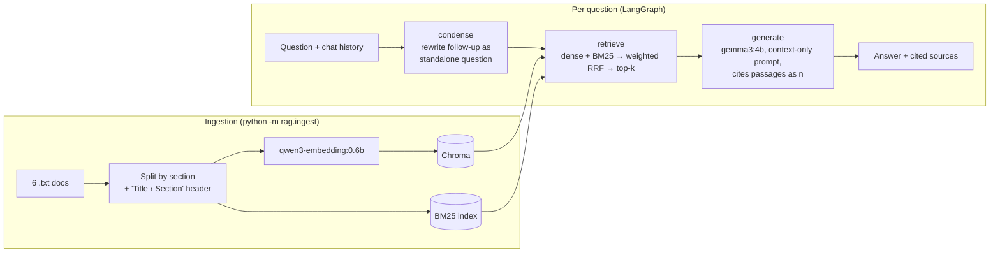

# Car Support Assistant — local RAG chatbot

A local, privacy-friendly customer-service chatbot that answers questions about vehicle features, service, warranty, ordering, electric vehicles and support channels. It answers **only** from the company knowledge base, cites the passage behind every fact, handles follow-up questions, and says so when it doesn't know.

Everything runs on a laptop through [Ollama](https://ollama.com). No data leaves the machine.

## Quick start

```bash
ollama pull gemma3:4b                # chat model
ollama pull qwen3-embedding:0.6b     # embedding model

python -m venv .venv && .venv\Scripts\activate     # (Linux/macOS: source .venv/bin/activate)
pip install -r requirements.txt

python -m rag.ingest                 # build the vector index (the app also does this on first start)
streamlit run app.py                 # chat UI → http://localhost:8501
```

Other commands:
- `python -m pytest`: unit tests, no Ollama needed.
- `python -m eval.run_eval`: the evaluation, which writes [eval/results.md](eval/results.md).

Models and Top-K can be changed with environment variables (`CHAT_MODEL`, `EMBED_MODEL`, `TOP_K`, `OLLAMA_URL`) or in the UI sidebar.

## Architecture



| File | Role |
|---|---|
| [rag/ingest.py](rag/ingest.py) | Load docs, split by section, embed and store in Chroma (rebuilds automatically when sections are added or removed) |
| [rag/retrieval.py](rag/retrieval.py) | `dense` / `bm25` / `hybrid` retrieval; Reciprocal Rank Fusion |
| [rag/graph.py](rag/graph.py) | LangGraph pipeline `condense → retrieve → generate`, prompts, citation parsing |
| [app.py](app.py) | Streamlit chat UI: streaming answers, cited sources with passages, history, settings sidebar |
| [eval/](eval/) | Golden question set (44 questions) and the evaluation script |
| [tests/](tests/) | Unit tests for the splitter, RRF and citation parsing |

## Key decisions and why

| Decision | Why | Evidence |
|---|---|---|
| **RAG instead of fine-tuning** | The knowledge changes (prices, warranty terms, opening hours). With RAG an update is just re-running ingestion, with no retraining, and every answer can be traced to a source document. | – |
| **Split by section, not by fixed size** | The docs are structured (`Paintwork Warranty:` followed by bullets). A 500-character window can cut "Duration: 3 years" away from the heading that says *which* warranty it is. One chunk per section keeps each fact with its context. Each chunk is prefixed with `Title › Section`, so a chunk about "8 years" still says it belongs to the *battery warranty*. This gives 30 chunks, all under 500 characters. | Natural-language questions with dense search: 100% Hit@1 |
| **Hybrid retrieval: dense + BM25, fused with weighted RRF** | Dense embeddings understand paraphrases ("my car broke down at night" finds *Roadside Assistance*) but are weaker on exact terms and acronyms ("SOS button", "CBS", "WLTP"). BM25 is the reverse. RRF combines the two *rankings*, so cosine scores and BM25 scores never need to be put on the same scale. | See the retrieval table below: hybrid is the only mode that scores well on **both** kinds of query |
| **BM25 at half weight (0.5)** | With only about 30 short chunks, BM25 is noisy on natural questions (the word "car" matches "digital *car* key"). Equal weights let that noise win the top position. At half weight BM25 still decides close calls on exact terms. | Natural Hit@1: 88% (w=1.0) → 92% (w=0.5) → 92% (w=0.3); keyword Hit@1 stays at 100% |
| **Stopwords removed for BM25** | Very short chunks otherwise rank highly just for containing "the", "is" and "how". | Seen in testing: before the fix, a 2-line CBS paragraph was BM25's top result for "How long is the warranty on the EV battery?" |
| **LangGraph `condense` step** | Customers ask follow-ups such as "How long does *it* last?". Searching with that sentence alone finds nothing useful. A short model call first rewrites it as a standalone question. The chat history is given to the model as a *transcript* inside one prompt. When it was passed as real chat turns, the small models answered the question instead of rewriting it, which the evaluation caught. | Follow-up retrieval Hit@1: 2/4 with the raw question → **4/4** after rewriting |
| **Numbered passages, citations `[n]`, only cited sources shown** | Customers and support agents need to be able to check an answer. Showing only the passages the answer actually cites, with the passage text available on click, makes each answer checkable rather than a vague list of files. | 94–100% of answers cite a relevant passage |
| **Fixed refusal sentence** | Out-of-scope questions get one exact, detectable sentence that points to the hotline, so refusals can be tested automatically. | 4/4 out-of-scope questions refused, including the tricky in-domain "How much horsepower does your top model have?" |
| **`gemma3:4b` as chat model** | Best answer quality among the small local models I tested, at about 2.7 s per answer on a 6 GB laptop GPU. `granite4:3b` is about 3× faster but less accurate. `qwen3:4b` (2507) is a thinking-only build, about 50 s per answer, so the sidebar hides thinking models. | See the model comparison below |
| **`qwen3-embedding:0.6b` as embedding model** | Small (0.6B), multilingual (useful for an international car maker) and strong on retrieval benchmarks. Each embedding model gets its own Chroma collection, so switching models never mixes vector spaces. | Dense search: 100% Hit@1 on natural questions |
| **temperature 0, top-k = 4** | Same question, same answer, which suits customer service and makes the evaluation repeatable. With 4 chunks, every relevant passage is retrieved (Hit@4 = 100%) and the prompt stays small. | Hit@4 = 100% in every group |

## Evaluation

`eval/golden.jsonl` contains 44 hand-written questions:
- 26 natural questions, paraphrased so they don't reuse the documents' wording
- 10 keyword-style queries (e.g. "SOS button", "WLTP range")
- 4 follow-ups with chat history
- 4 out-of-scope questions

The script measures retrieval for each mode, then runs the full pipeline and checks three things: the expected facts are in the answer, a cited passage is a relevant one, and out-of-scope questions are refused.

**Retrieval** (`qwen3-embedding:0.6b`, k = 4)

| Mode | Natural Hit@1 | Natural Hit@4 | Keyword Hit@1 | Keyword Hit@4 | MRR@10 (all) |
|---|---|---|---|---|---|
| **hybrid** (default) | 92% | 100% | **100%** | 100% | 0.965 |
| dense | **100%** | 100% | 80% | 100% | 0.968 |
| bm25 | 69% | 88% | **100%** | 100% | 0.836 |

**End-to-end** (hybrid, k = 4)

| Chat model | Single-turn correct | Follow-up correct | Out-of-scope refused | Cites a relevant passage | Latency / answer |
|---|---|---|---|---|---|
| **gemma3:4b** (default) | **100%** (36/36) | **100%** (4/4) | 100% (4/4) | 94% / 100% | 2.7 s |
| granite4:3b | 89% (32/36) | 100% (4/4) | 100% (4/4) | 94% / 100% | 0.8 s |

These numbers are from an RTX 3060 laptop GPU with 6 GB. The full report, including every failure, is in [eval/results.md](eval/results.md). The remaining gemma failures are citation slips: the fact is correct but the wrong passage number is cited.

**How to read this:** on such a small, clean knowledge base every mode reaches Hit@4 = 100%. The modes only differ at rank 1, and that is where hybrid is the balanced choice. The set has 44 questions, so each percentage point rests on a handful of them. The results support the design choices, but they are not a benchmark.

## Limitations

- **Small knowledge base.** 6 documents and 30 chunks: retrieval is easy, and the evaluation can't tell good strategies apart at k ≥ 4. Chunking assumes the docs' `Heading:` format, and long sections are not split further.
- **Small model.** A 4B model sometimes cites the wrong passage number, and it can't do multi-step reasoning across many documents.
- **Eval checks by keyword.** Facts are checked by keyword matching, not by a human or an LLM judge, and the golden set was written by the same person who built the system.
- **No caching or guardrails.** There is no answer cache, no PII filtering and no prompt-injection defence.
- **Index refresh.** The index rebuilds automatically when sections are added or removed. Editing text *inside* a section needs `python -m rag.ingest`.

## Roadmap to production

1. **Data:** connect real sources (CMS, PDFs, the dealer portal) with incremental re-indexing and metadata filters for market, model and language.
2. **Retrieval:** add a cross-encoder reranker once the corpus has thousands of chunks, and grow the golden set from real, anonymised customer questions.
3. **Models:** use a larger served model (e.g. vLLM on a GPU server, or a managed API), plus an LLM-as-judge evaluation in CI to catch regressions.
4. **Product:** hand over to a human agent with the conversation context, connect to the CRM to create tickets, and add a thumbs up/down feedback loop.
5. **Operations:** FastAPI backend, tracing (LangSmith or OpenTelemetry), cost and latency dashboards, and guardrails for PII and prompt injection.
